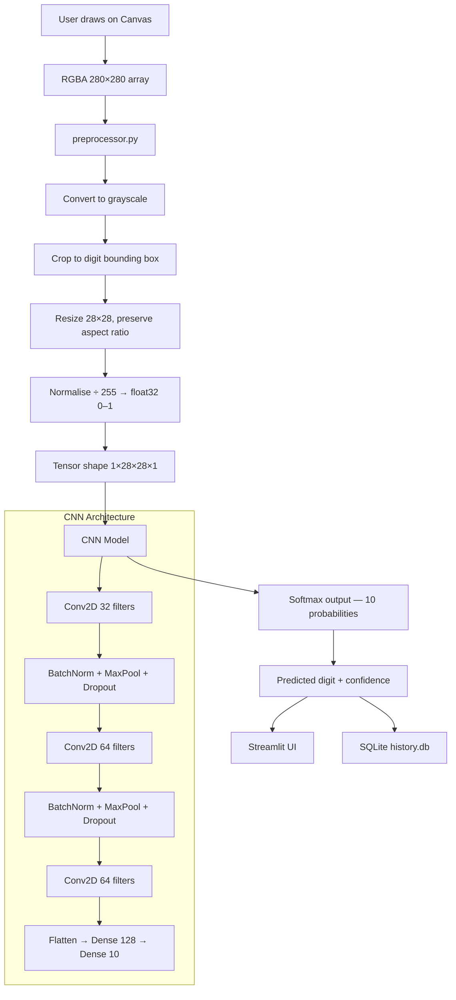

# Handwritten Digit Recognition — Mini Project

A full-stack machine learning application that recognises handwritten digits
(0–9) using a Convolutional Neural Network trained on the MNIST dataset.
Built as a college mini-project with a complete interactive web interface,
prediction history, model performance dashboard, and automated tests.

---

## Features

| Feature | Description |
|---|---|
| ✏️ Draw & Predict | Freehand canvas with real-time CNN inference |
| 📋 Prediction History | SQLite-backed log of every prediction (no images stored) |
| 📊 Model Dashboard | Real MNIST test metrics — accuracy, F1, confusion matrix |
| 🧪 Automated Tests | 82 pytest tests covering preprocessing, segmentation, history, and model inference |
| 🎲 MNIST Examples | Load real test-set images with one click |
| 🔍 Input Preview | Shows the exact 28×28 tensor fed to the model |

---

## Project Structure

```
digit_recognition/
│
├── main.py                  ← Phase 1 entry point (train + evaluate)
├── train.py                 ← CNN training pipeline
├── evaluate.py              ← Full evaluation metrics
├── data_loader.py           ← MNIST loading + preprocessing
├── model.py                 ← CNN architecture definition
├── plot_training.py         ← Training curve charts
├── config.py                ← All constants in one place
├── requirements.txt         ← Pinned dependencies
│
├── webapp/                  ← Phase 2 & 3 Streamlit application
│   ├── app.py               ← Main UI (3 tabs)
│   ├── preprocessor.py      ← Canvas → 28×28 tensor pipeline
│   ├── predictor.py         ← Model loading + inference
│   ├── history.py           ← SQLite prediction history
│   ├── dashboard.py         ← Model metrics + chart rendering
│   ├── charts.py            ← Probability bar chart
│   ├── styles.py            ← Custom CSS
│   └── __init__.py
│
├── tests/                   ← Automated test suite
│   ├── test_preprocessor.py ← 26 preprocessing tests
│   ├── test_predictor.py    ← 35 model inference tests
│   ├── test_history.py      ← 13 SQLite history / isolation tests
│   └── test_segmentation.py ← 8 multi-digit segmentation tests
│
├── models/
│   └── digit_recognizer.keras  ← Saved trained model
│
├── data/
│   ├── preprocessing_config.json
│   └── prediction_history.db   ← SQLite file (created at first run)
│
├── outputs/
│   ├── confusion_matrix.png
│   ├── training_curves.png
│   └── sample_predictions.png
│
└── .streamlit/
    └── config.toml          ← Dark theme settings
```

---

## Architecture Diagram



---

## Installation (Windows)

### Prerequisites
- Python 3.9, 3.10, or 3.11 (NOT 3.12/3.13 — TensorFlow 2.17 incompatible)
- Check: `python --version`

### Step-by-step

```powershell
# 1. Navigate to the project (wherever you cloned/downloaded it)
cd "path\to\digit_recognition"

# 2. Create a virtual environment
python -m venv venv

# 3. Activate it  (you should see (venv) in your prompt)
venv\Scripts\activate

# 4. Install all dependencies
pip install -r requirements.txt
```

---

## Usage

### Train the model (Phase 1 — run once)
```powershell
python main.py
```
- Downloads MNIST (~11 MB, first run only)
- Trains for up to 15 epochs (~3–8 minutes on CPU)
- Saves `models/digit_recognizer.keras`
- Saves evaluation charts to `outputs/`

### Launch the web app (Phase 2 & 3)
```powershell
streamlit run webapp/app.py
```
Open **http://localhost:8501** in your browser.

### Run the automated tests
```powershell
python -m pytest tests/ -v
```

---

## Dataset — MNIST

| Property | Value |
|---|---|
| Full name | Modified National Institute of Standards and Technology |
| Total images | 70,000 greyscale handwritten digits |
| Training set | 60,000 images |
| Test set | 10,000 images |
| Image size | 28 × 28 pixels |
| Pixel values | 0 (black) to 255 (white) |
| Classes | 10 (digits 0–9) |
| Source | `tf.keras.datasets.mnist` |

---

## CNN Architecture

| Layer | Output Shape | Parameters | Purpose |
|---|---|---|---|
| Input | 28×28×1 | 0 | Accepts greyscale image |
| Conv2D (32 filters) | 28×28×32 | 320 | Detects edges and curves |
| BatchNorm + MaxPool | 14×14×32 | — | Stabilise + downsample |
| Dropout 0.25 | 14×14×32 | — | Prevent overfitting |
| Conv2D (64 filters) | 14×14×64 | 18,496 | Detects shapes |
| BatchNorm + MaxPool | 7×7×64 | — | Stabilise + downsample |
| Dropout 0.25 | 7×7×64 | — | Prevent overfitting |
| Conv2D (64 filters) | 7×7×64 | 36,928 | Detects complex patterns |
| BatchNorm + Dropout | 7×7×64 | — | Regularisation |
| Flatten | 3136 | 0 | 3D → 1D |
| Dense (128) | 128 | 401,536 | Decision-making layer |
| BatchNorm + Dropout 0.5 | 128 | — | Regularisation |
| Dense (10) + Softmax | 10 | 1,290 | Output: 10 class probabilities |

**Total parameters:** ~460,000  
**Optimizer:** Adam | **Loss:** Sparse Categorical Crossentropy

---

## Preprocessing Pipeline

Raw drawing → model tensor in 6 steps:

1. **RGBA → Grayscale** — drop colour, keep brightness
2. **Crop to bounding box** — isolate just the drawn digit
3. **Resize to 28×28** — preserve aspect ratio (letterbox, not squish)
4. **Gentle Gaussian blur** — smooth jagged mouse strokes
5. **Normalise ÷ 255** — pixel values 0–255 → 0.0–1.0 (float32)
6. **Add batch + channel dims** — shape `(28,28)` → `(1,28,28,1)`

---

## Model Evaluation

Metrics are computed on the **MNIST test set (10,000 unseen images)**
by `evaluate.py` (Phase 1) and cached in `data/eval_metrics.json`.

| Metric | Expected value |
|---|---|
| Test Accuracy | ≥ 99.0% |
| Test Loss | ≤ 0.04 |
| Macro F1-Score | ≥ 0.99 |
| Per-class accuracy | ≥ 97% for every digit |

---

## Testing

82 automated tests in four files:

| File | Tests | What it verifies |
|---|---|---|
| `test_preprocessor.py` | 26 | Tensor shape, dtype, range, polarity, aspect ratio, all 10 MNIST digits |
| `test_predictor.py` | 35 | Model loading, output structure, softmax sum, per-class accuracy ≥ 97%, edge cases |
| `test_history.py` | 13 | Save/read, per-session isolation, feedback, single delete, CSV export, schema migration |
| `test_segmentation.py` | 8 | Multi-digit component detection, left-to-right ordering, noise filtering |

```powershell
# Run all tests with details
python -m pytest tests/ -v

# Run only preprocessor tests
python -m pytest tests/test_preprocessor.py -v

# Run only predictor tests
python -m pytest tests/test_predictor.py -v
```

---

## Known Limitations

| Limitation | Reason |
|---|---|
| Accuracy drops on real handwriting | MNIST uses printed-style digits; cursive or stylised digits may fail |
| Single digit only | The model classifies one digit per image; multi-digit input is not supported |
| Stroke thickness matters | Very thin strokes may lose detail at 28×28; use stroke width ≥ 15 |
| Position matters less with cropping | But extreme corner placement may clip the digit |
| Mobile canvas | Touch drawing works but may produce thinner strokes than mouse |

---

## Future Enhancements (Phase 4+)

- [x] Export prediction history as CSV
- [ ] Custom drawing style calibration
- [ ] REST API endpoint for external integrations
- [ ] Model retraining with user-drawn data
- [ ] Retrain on real user feedback (collected via the "correct this prediction" option)

---

## Viva Questions & Answers

**Q1: What is MNIST?**
A dataset of 70,000 handwritten digit images (28×28 pixels, greyscale),
split into 60,000 training and 10,000 test images. It is the standard
benchmark for image classification beginners.

**Q2: Why use a CNN instead of a regular neural network?**
A regular network treats every pixel independently and loses spatial
relationships. A CNN uses filters that scan small regions (3×3) of the
image, so it learns that a curve in one corner is related to a curve in
another — exactly how we read shapes.

**Q3: What does MaxPooling do?**
It divides the feature map into 2×2 blocks and keeps only the maximum
value from each block. This halves the image dimensions, reducing
computation and making the model tolerant to small shifts in digit position.

**Q4: What is Dropout and why use it?**
Dropout randomly disables a percentage of neurons during training.
This prevents the model from relying too heavily on any single neuron,
forcing it to learn more robust, generalised features. It reduces overfitting.

**Q5: What is Softmax?**
A mathematical function applied to the last layer that converts raw scores
into probabilities. The 10 output values all become positive and sum to 1.0,
so each represents the model's confidence for that digit class.

**Q6: Why do you normalise pixel values?**
Raw pixels range from 0 to 255. Gradient-based optimisers (like Adam) work
much better when input values are small and in a consistent range (0 to 1).
Unnormalised inputs cause unstable training.

**Q7: Why does drawn digit accuracy differ from 99% test accuracy?**
MNIST images are centred, uniformly sized, and drawn with a specific pen
style. User drawings on a mouse canvas have different stroke width, angle,
and style. The preprocessing pipeline (crop + centre + resize) narrows this
gap but cannot eliminate it entirely.

**Q8: What is the confusion matrix?**
A 10×10 grid where row i = true digit, column j = predicted digit.
The diagonal shows correct predictions. Off-diagonal entries show which
digits the model confuses — for example, 4 and 9 look similar and are
common confusion pairs.

**Q9: Why SQLite for history storage?**
SQLite is a lightweight database stored as a single file — no separate
database server needed. Python includes it in the standard library.
It persists across browser refreshes and application restarts, unlike
Streamlit's session_state which resets each time.

**Q10: How would you improve the model further?**
Use data augmentation (random rotations, shifts, zoom) during training to
make it more robust to real handwriting variation. Increase model depth,
use learning rate warmup, or fine-tune on user-drawn images collected
through the app itself.

---

## Screenshots Checklist (for report)

- [ ] Draw & Predict tab — canvas with drawn digit
- [ ] Prediction result card showing predicted digit + confidence
- [ ] Probability bar chart
- [ ] 28×28 preprocessed input preview
- [ ] Prediction History tab with filled table
- [ ] History digit distribution chart
- [ ] Model Dashboard — KPI metrics row
- [ ] Per-class precision/recall/F1 table
- [ ] F1-score bar chart
- [ ] Confusion matrix

---

## Dependencies

| Package | Version | Purpose |
|---|---|---|
| tensorflow | 2.17.0 | CNN model training and inference |
| numpy | 1.26.4 | Array operations |
| matplotlib | 3.9.2 | Charts and visualisations |
| scikit-learn | 1.5.2 | Confusion matrix, classification report |
| streamlit | 1.39.0 | Web application framework |
| streamlit-drawable-canvas | 0.9.3 | Drawing canvas component |
| Pillow | 10.4.0 | Image processing |
| pyarrow | 14.0.2 | Required by Streamlit canvas component |
| pandas | 2.2.3 | Data tables in Streamlit |
| pytest | 8.3.3 | Automated test runner |
